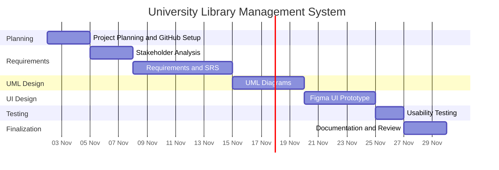

# Gantt Chart

## University Library Management System

This Gantt chart shows the planned timeline for completing the project activities.

**Note:** These dates are planned estimates and can be adjusted according to the instructor's deadline.
